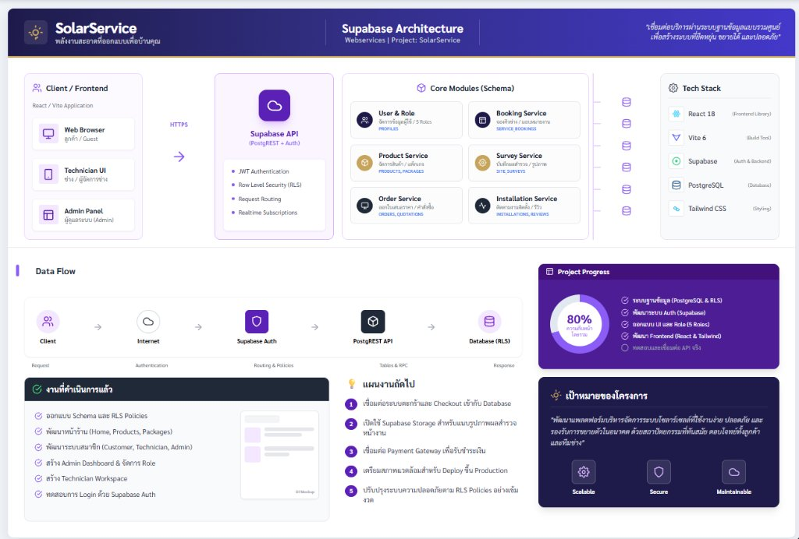

<div align="center">

# ☀️ SolarService (โซลาร์เซอร์วิส)
### พลังงานสะอาดที่ออกแบบเพื่อบ้านคุณ · ระบบบริหารจัดการธุรกิจโซลาร์เซลล์และบริการหลังการขายครบวงจร

ระบบเว็บแอปพลิเคชันระดับองค์กร (Enterprise Full-Stack Platform) ที่ครอบคลุมตั้งแต่การเลือกซื้ออุปกรณ์โซลาร์เซลล์, แพ็กเกจติดตั้ง, การจองคิวช่างสำรวจหน้างาน, ออกใบเสนอราคา, ควบคุมขั้นตอนการติดตั้ง, ทะเบียนรับประกันสินค้า (Serial Number), ระบบแจ้งเตือนล้างแผงบำรุงรักษา, ระบบแจ้งซ่อม (Ticketing) ไปจนถึง CRM ลูกค้า 360 องศา

<br />

[](https://react.dev/)
[](https://vitejs.dev/)
[](https://supabase.com/)
[](#)

<br /><br />



</div>

---

## 🧭 สารบัญเนื้อหา (Table of Contents)

1. [ภาพรวมของแพลตฟอร์ม (Platform Overview)](#-ภาพรวมของแพลตฟอร์ม-platform-overview)
2. [สถาปัตยกรรมบทบาทผู้ใช้ (User Roles & Access Control)](#-สถาปัตยกรรมบทบาทผู้ใช้-user-roles--access-control)
3. [ฟังก์ชันการทำงานแยกตามระบบ (Core Systems & Features)](#-ฟังก์ชันการทำงานแยกตามระบบ-core-systems--features)
   - [3.1 หน้าร้านและอีคอมเมิร์ซ (Public & E-Commerce Storefront)](#31-หน้าร้านและอีคอมเมิร์ซ-public--e-commerce-storefront)
   - [3.2 พอร์ทัลลูกค้า (Customer Workspace)](#32-พอร์ทัลลูกค้า-customer-workspace)
   - [3.3 พอร์ทัลช่างผู้เชี่ยวชาญ (Technician Portal)](#33-พอร์ทัลช่างผู้เชี่ยวชาญ-technician-portal)
   - [3.4 ระบบบริหารจัดการระดับองค์กร (Enterprise Admin Workspace - 15 โมดูล)](#34-ระบบบริหารจัดการระดับองค์กร-enterprise-admin-workspace)
4. [ผังการดำเนินงานธุรกิจ (Operational Workflow)](#-ผังการดำเนินงานธุรกิจ-operational-workflow)
5. [โครงสร้างฐานข้อมูลและระบบความปลอดภัย (Database Schema & RLS)](#-โครงสร้างฐานข้อมูลและระบบความปลอดภัย-database-schema--rls)
6. [โครงสร้างโปรเจกต์ (Project Structure)](#-โครงสร้างโปรเจกต์-project-structure)
7. [ขั้นตอนการติดตั้งและเริ่มใช้งาน (Getting Started)](#-ขั้นตอนการติดตั้งและเริ่มใช้งาน-getting-started)

---

## 🌟 ภาพรวมของแพลตฟอร์ม (Platform Overview)

**SolarService** ถูกพัฒนาขึ้นเพื่อแก้ปัญหาความซับซ้อนในการติดตั้งและดูแลรักษาระบบโซลาร์เซลล์ โดยรวบรวมทุกขั้นตอนการทำงานระหว่าง **ลูกค้า (Customer)**, **ทีมช่างเทคนิค (Technician)** และ **ฝ่ายบริหารจัดการ (Admin/Staff)** ให้อยู่บนระบบดิจิทัลเดียวกันแบบไร้รอยต่อ

- **หน้าบ้าน (Storefront & Portals)**: รองรับการเข้าชมทั้งบนมือถือและคอมพิวเตอร์ (Responsive Design 100%) พร้อมระบบค้นหา กรองหมวดหมู่ ตะกร้าสินค้า และพอร์ทัลแยกตามบทบาท
- **ระบบหลังบ้าน (Enterprise Admin)**: ระบบโมดูลาร์ 15 เครื่องมือที่ครอบคลุมงานขาย, คลังสินค้า, การเงิน, คิวช่าง, ทะเบียนประกัน, CRM และการตลาด
- **ความทนทานของข้อมูล (Data Resilience)**: สถาปัตยกรรม Service Layer (`adminService.js`) รองรับทั้งการเชื่อมต่อสดกับฐานข้อมูล **Supabase PostgreSQL** และมีกลไก Local Fallback Data อัตโนมัติ ทำให้ระบบสามารถแสดงผลและทำงานต่อเนื่องได้ตลอดเวลา

### 📐 สถาปัตยกรรมระบบและการไหลของข้อมูล (Architecture & Data Flow)
- **Client / Frontend Layer (React 18 + Vite 6)**:
  - 🖥️ **Web Browser (ลูกค้า / Guest)**: ร้านค้าออนไลน์, พอร์ทัลลูกค้า, ตะกร้าสินค้า และระบบจองคิว
  - 📱 **Technician UI (ช่างเทคนิค)**: ตารางงานประจำวัน, ฟอร์มสำรวจหน้างาน (Survey) และรายงานสถานะ
  - 🏢 **Admin Panel (ผู้ดูแลระบบ)**: พอร์ทัลบริหารจัดการ 15 เครื่องมือ, CRM 360°, รายงาน และการเงิน
- **Backend & Webservices (Supabase API)**:
  - ตรวจสอบความถูกต้องและสิทธิ์ผู้ใช้งานด้วย **JWT Authentication**
  - ป้องกันและจำกัดการเข้าถึงข้อมูลตามบทบาทด้วย **Row Level Security (RLS)**
  - จัดการเส้นทางคำขออัตโนมัติผ่าน PostgREST Engine
- **Core Modules & Services (Schema)**:
  - 👤 **User & Role**: จัดการโปรไฟล์และระดับสิทธิ์ (`profiles`)
  - 📅 **Booking Service**: คิวจองช่างสำรวจและการมอบหมายงาน (`service_bookings`)
  - 📦 **Product Service**: แคตตาล็อกสินค้า, สต็อก และแพ็กเกจติดตั้ง (`products`, `packages`)
  - 📐 **Survey Service**: รายละเอียดหลังคา, ทิศทาง และภาพถ่ายสำรวจ (`site_surveys`)
  - 📄 **Order Service**: ใบเสนอราคา, คำสั่งซื้อ และยอดชำระ (`orders`, `quotations`)
  - 🔧 **Installation Service**: ติดตามงานติดตั้ง, ทะเบียนรับประกัน และรีวิว (`installations`, `warranties`)
- **Data Flow Pipeline**:
  $$\text{Client} \longrightarrow \text{HTTPS / Internet} \longrightarrow \text{Supabase Auth} \longrightarrow \text{PostgREST API} \longrightarrow \text{PostgreSQL (RLS)} \longrightarrow \text{Response}$$

---

## 👥 สถาปัตยกรรมบทบาทผู้ใช้ (User Roles & Access Control)

ระบบใช้มาตรฐาน **Role-Based Access Control (RBAC)** ควบคู่กับ **Row Level Security (RLS)** ใน PostgreSQL:

| บทบาท (Role) | สิทธิ์และการเข้าถึง (Permissions & Access) | Landing Route |
|---|---|---|
| **Guest** (ผู้เยี่ยมชม) | ดูสินค้า, แพ็กเกจ, บทความ CMS, ข้อมูลบริษัท, สมัครสมาชิก, เข้าสู่ระบบ | `/` |
| **Customer** (ลูกค้า) | สั่งซื้ออุปกรณ์, จองคิวสำรวจหน้างาน, ดูใบเสนอราคา, ติดตามงานติดตั้ง, จัดการบัญชี/รหัสผ่าน | `/customer` |
| **Technician** (ช่าง) | ดูตารางงานส่วนบุคคล, รายละเอียดหน้างาน, บันทึกผลสำรวจ (Survey Form), ตรวจเช็คสถานะงาน | `/technician` |
| **Admin / Staff** (ผู้ดูแล) | ควบคุม 15 ระบบบริหาร, จัดการสินค้า/สต็อก, ตรวจสลิป, ออกใบเสนอราคา, ควบคุมงานติดตั้ง, CRM 360° | `/admin` |

---

## 🚀 ฟังก์ชันการทำงานแยกตามระบบ (Core Systems & Features)

### 3.1 หน้าร้านและอีคอมเมิร์ซ (Public & E-Commerce Storefront)
- **หน้าแรก (`/`)**: Hero Banner โปรโมชั่นที่ดึงจาก CMS, จุดเด่นบริการ, สินค้าไฮไลต์, และรีวิวจากลูกค้าจริง
- **รายการสินค้าและอุปกรณ์ (`/products`)**: ดึงสินค้าที่แอดมินเผยแพร่จาก Supabase พร้อมราคา รายละเอียด และรูปสินค้าที่ตั้งไว้ในระบบแอดมิน รองรับค้นหาและกรองหมวดหมู่; เมื่อแอดมินเพิ่ม แก้ไข ซ่อน หรือลบสินค้า รายการหน้าร้านจะโหลดข้อมูลล่าสุด
- **แพ็กเกจติดตั้งโซลาร์รูฟท็อป (`/packages`)**: แสดงแพ็กเกจมาตรฐาน 3 kW, 5 kW, 10 kW และระบบไฮบริด พร้อมปุ่มนัดสำรวจทันที
- **บริการช่างและโซลูชัน (`/services`)**: รายละเอียดขั้นตอนการดำเนินงาน ตั้งแต่เข้าสำรวจ ยื่นขออนุญาตขนานไฟ กฟน./กฟภ. จนถึงส่งมอบงาน
- **ระบบตะกร้าและสั่งซื้อ (`/cart`, `/checkout`)**: ใช้สินค้าจากแคตตาล็อกที่เผยแพร่ บันทึกชื่อสินค้า ราคา และจำนวนลงคำสั่งซื้อจากฐานข้อมูล จากนั้นสร้าง QR PromptPay ตามยอดจริงและแสดงรายละเอียดสินค้าก่อนชำระ
- **การชำระเงิน PromptPay**: ลูกค้าสร้าง QR จากหน้า Checkout; แอดมินสร้าง QR จากคำสั่งซื้อในหน้าจัดการออเดอร์ โดย Express API ใช้ Stripe Secret Key ฝั่งเซิร์ฟเวอร์เท่านั้นและส่ง URL ภาพ QR กลับให้หน้าเว็บ เมื่อ Stripe webhook ยืนยันรับชำระ ระบบจะอัปเดตสถานะคำสั่งซื้อและการชำระเงิน
- **ระบบจัดการบัญชีและความปลอดภัย (`/account`, `/profile`)**:
  - เปลี่ยนชื่อและเบอร์โทรศัพท์ติดต่อ
  - ตรวจสอบสถานะบทบาทและรหัสบัญชี
  - เปลี่ยนรหัสผ่านโดยตรง พร้อมระบบตรวจสอบความยาวและความปลอดภัย
  - ส่งอีเมลขอรีเซ็ตรหัสผ่านผ่าน Supabase Auth Service

---

### 3.2 พอร์ทัลลูกค้า (Customer Workspace)
- **ภาพรวมบัญชี (`/customer`)**: แดชบอร์ดสรุปจำนวนคำสั่งซื้อ คิวจองสำรวจ และใบเสนอราคา
- **ระบบจองคิวสำรวจพื้นที่ (`/bookings`)**:
  - ตรวจสอบความพร้อมของ Slot เวลาว่างจริงจากฐานข้อมูล
  - ป้องกันการเลือกวันย้อนหลัง
  - บันทึกพิกัดที่อยู่ รายละเอียดประเภทหลังคา และเบอร์โทรศัพท์
- **ใบเสนอราคาของฉัน (`/quotes`)**: ตรวจสอบรายละเอียดและยอดเงินของใบเสนอราคาที่ได้รับ
- **ติดตามงานติดตั้ง (`/tracking`)**: อัปเดตความคืบหน้าของงานติดตั้งแบบเรียลไทม์

---

### 3.3 พอร์ทัลช่างผู้เชี่ยวชาญ (Technician Portal)
- **ภาพรวมงานช่าง (`/technician`)**: แสดงงานที่ได้รับมอบหมายล่าสุดจากตาราง `technician_assignments`
- **ตารางนัดหมายประจำวัน (`/schedule`)**: แยกรายการนัดหมายวันนี้และงานล่วงหน้า พร้อมเบอร์โทรและที่อยู่ลูกค้า
- **งานที่อยู่ระหว่างดำเนินการ (`/jobs`)**: ควบคุมงานสำรวจและงานติดตั้งที่ต้องเข้าปฏิบัติการ
- **แบบฟอร์มบันทึกผลสำรวจหน้างาน (`/survey`)**: บันทึกขนาดพื้นที่หลังคา (ตร.ม.), ประเภทหลังคา (ซีแพค/เมทัลชีท/คอนกรีต), ทิศทางแดด, ขนาดระบบที่แนะนำ และแนบรูปถ่ายหน้างาน
- **ประวัติงาน (`/work-history`)**: รวมผลงานที่เสร็จสิ้นสมบูรณ์

---

### 3.4 ระบบบริหารจัดการระดับองค์กร (Enterprise Admin Workspace)

พอร์ทัลผู้ดูแลระบบแบ่งเป็น 15 โมดูลหลัก พร้อม **Sub Navigation Bar** แสดงตัวเลขแจ้งเตือน (Badges) แบบเรียลไทม์:

```
[ Dashboard ] [ รายงานสถิติ ] [ จัดการสินค้า ] [ แพ็กเกจติดตั้ง ] [ คำสั่งซื้อ (1) ] 
[ ตรวจสลิป (1) ] [ คิวจองสำรวจ (1) ] [ ใบเสนอราคา ] [ งานติดตั้ง (2) ] [ ทะเบียนรับประกัน ] 
[ รอบบำรุงรักษา (3) ] [ แจ้งซ่อม (2) ] [ CRM ผู้ใช้ ] [ จัดการรีวิว ] [ เนื้อหา CMS ]
```

```
                                  ENTERPRISE ADMIN WORKSPACE
 ┌─────────────────────────────────────────────────────────────────────────────────────────────┐
 │  1. Executive Dashboard      │ กราฟแนวโน้มยอดขาย SVG Curve, รายได้สะสม, สัดส่วนสินค้า/แพ็กเกจ  │
 │  2. Financial Reports        │ วิเคราะห์รายได้ 1m/3m/6m/1y พร้อมส่งออก Excel / CSV            │
 │  3. Inventory & Products     │ จัดการสต็อก, แจ้งเตือนสินค้าใกล้หมด (<10 ชิ้น), ปรับราคา/สเปก   │
 │  4. Solar Packages           │ บริหารแพ็กเกจ 3kW, 5kW, 10kW และระบบ Hybrid Storage         │
 │  5. Orders & Logistics       │ จัดการออเดอร์, อัปเดตสถานะจัดส่ง, บันทึกเลขพัสดุ (Tracking No.) │
 │  6. Payment Verification     │ ตรวจสลิปโอนเงิน (Image Lightbox Modal), ปุ่ม Approve/Reject   │
 │  7. Booking & Site Survey    │ จัดคิวสำรวจ, มอบหมายช่างจริง, ฟอร์มรับจองใหม่ทางโทรศัพท์           │
 │  8. Quotation Engine         │ ออกใบเสนอราคา, หน้า Official Sheet Preview สั่งพิมพ์ได้ทันที   │
 │  9. Installation Pipeline    │ ติดตาม 5 ขั้นตอนหน้างาน (Checklist), บันทึกหัวหน้าช่างผู้รับผิดชอบ │
 │ 10. Warranty Registry (SN)   │ ทะเบียน Serial Number แผง/อินเวอร์เตอร์/แบตเตอรี่, พิมพ์ใบรับประกัน │
 │ 11. Maintenance Reminders    │ ระบบแจ้งเตือนล้างแผงโซลาร์ทุก 6 เดือน (Recurring Revenue Engine) │
 │ 12. Support & Tickets        │ ระบบแจ้งซ่อมอุปกรณ์, จัดลำดับความเร่งด่วน (Urgent 🔥), บันทึกแก้ไข │
 │ 13. Users CRM & 360° Profile │ ดูประวัติลูกค้าครบวงจร (คำสั่งซื้อ/คิวจอง/ประกัน), เปลี่ยน Role, แบน │
 │ 14. Customer Reviews         │ คัดกรองและสลับสถานะเผยแพร่รีวิว (Publish / Hide) หน้าร้าน     │
 │ 15. Headless CMS             │ จัดการแบนเนอร์โปรโมชั่นหน้าแรก และบทความสาระน่ารู้โซลาร์เซลล์     │
 └─────────────────────────────────────────────────────────────────────────────────────────────┘
```

---

## 🔄 ผังการดำเนินงานธุรกิจ (Operational Workflow)

กระบวนการดำเนินงานตั้งแต่ต้นน้ำจนถึงบริการหลังการขาย:

```
[ ลูกค้า / Customer ]                [ ระบบ / Admin ]                 [ ทีมช่าง / Technician ]
         │                                   │                                    │
         ├─── 1. เลือกแพ็กเกจ / จองสำรวจ ───>│                                    │
         │                                   ├─── 2. มอบหมายช่างผู้รับผิดชอบ ────>│
         │                                   │                                    ├── 3. เข้าสำรวจหน้างาน
         │                                   │<── 4. ส่งผลสำรวจและสเปกหลังคา ─────┤
         │                                   │                                    │
         │<── 5. รับใบเสนอราคา (Quotation) ──┤                                    │
         ├─── 6. อนุมัติราคา & แนบสลิปมัดจำ ─>│                                    │
         │                                   ├─── 7. ตรวจสอบสลิป & นัดติดตั้ง ───>│
         │                                   │                                    ├── 8. เข้าติดตั้ง 5 ขั้นตอน
         │                                   │<── 9. ทดสอบขนานไฟ & ส่งมอบงาน ─────┤
         │<── 10. รับมอบงาน & ใบรับประกัน ───┤                                    │
         │    (Digital Warranty Certificate) │                                    │
         │                                   │                                    │
         │<── 11. แจ้งเตือนล้างแผงรอบ 6 เดือน ┤ (ระบบ Recurring Automation)        │
         ├─── 12. แจ้งซ่อมเมื่อพบปัญหา ──────>│ (Ticketing Engine)                 │
```

---

## 🗄️ โครงสร้างฐานข้อมูลและระบบความปลอดภัย (Database Schema & RLS)

ฐานข้อมูลทำงานบน **PostgreSQL** ผ่าน **Supabase** พร้อมระบบ Trigger ตรวจสอบเวลา และฟังก์ชันคำนวณอัตโนมัติ:

### ไฟล์ Migrations ในระบบ
1. [`backend/supabase/migrations/20261031200000_initial_schema.sql`](file:///c:/Users/peac8/Documents/GitHub/SolarService/backend/supabase/migrations/20261031200000_initial_schema.sql):
   - `profiles`: ข้อมูลผู้ใช้งาน สิทธิ์ (customer, technician, staff, admin)
   - `products`: สินค้า ราคา สต็อก และสถานะเผยแพร่
   - `packages`: แพ็กเกจติดตั้งมาตรฐาน
   - `orders` & `order_items`: คำสั่งซื้อและรายการสินค้า
   - `service_bookings`: รายการจองคิวสำรวจและติดตั้ง
   - `technician_assignments`: ความสัมพันธ์การมอบหมายงานให้ช่าง
   - `quotations` & `quotation_items`: ใบเสนอราคาทางการ
   - `installations`: งานติดตั้งและสถานะ
   - `payments`: การชำระเงินและสลิป
   - `reviews`: รีวิวและความคิดเห็น
2. [`backend/supabase/migrations/20261101230000_admin_enhancements.sql`](file:///c:/Users/peac8/Documents/GitHub/SolarService/backend/supabase/migrations/20261101230000_admin_enhancements.sql):
   - `warranties`: ทะเบียนรับประกันอุปกรณ์และ Serial Number
   - `maintenance_reminders`: การแจ้งเตือนรอบบำรุงรักษาและล้างแผงโซลาร์
   - `support_tickets`: เคสแจ้งซ่อมและปัญหาการใช้งาน
   - `cms_banners`: แบนเนอร์โปรโมชั่นหน้าแรก
   - `cms_articles`: บทความและสาระน่ารู้
   - อัปเดตคอลัมน์ `is_banned` และสิทธิ์ `staff` บนตาราง `profiles`

---

## 📁 โครงสร้างโปรเจกต์ (Project Structure)

โปรเจกต์ถูกแบ่งออกเป็น Workspaces ที่ชัดเจน:

```text
SolarService/
├── package.json                          # Workspace configuration & build scripts
├── README.md                             # เอกสารคู่มือระบบ
│
├── frontend/                             # React 18 + Vite Application
│   ├── .env.example                      # ตัวอย่างตัวแปร Environment
│   ├── .env.local                        # การเชื่อมต่อ Supabase จริง (Local)
│   ├── index.html
│   ├── package.json
│   ├── vite.config.js
│   └── src/
│       ├── main.jsx                      # จุดเริ่มต้นของแอปพลิเคชัน
│       ├── App.jsx                       # Routing & Auth state management
│       ├── styles.css                    # Design System & UI styling
│       ├── components/                   # Shared components (Header, Footer, UI)
│       ├── data/
│       │   └── catalog.js                # ข้อมูลเริ่มต้นสำรอง
│       ├── lib/
│       │   ├── routes.js                 # เส้นทางหน้าเว็บและชื่อหัวเรื่อง
│       │   └── supabase.js               # Supabase Client connection
│       ├── pages/
│       │   ├── Home.jsx                  # หน้าแรกของเว็บไซต์
│       │   ├── Products.jsx              # หน้ารวมสินค้า
│       │   ├── Packages.jsx              # หน้าแพ็กเกจติดตั้ง
│       │   ├── Services.jsx              # หน้าบริการช่าง
│       │   ├── About.jsx & Contact.jsx   # หน้าข้อมูลบริษัทและการติดต่อ
│       │   ├── AuthPage.jsx              # เข้าสู่ระบบ / สมัครสมาชิก / ลืมรหัสผ่าน
│       │   ├── AccountPage.jsx           # ข้อมูลส่วนตัว / เปลี่ยนรหัสผ่าน
│       │   ├── CartPages.jsx             # ตะกร้าสินค้าและยืนยันคำสั่งซื้อ
│       │   ├── WorkspacePage.jsx         # แดชบอร์ดลูกค้าและช่าง
│       │   ├── AdminWorkspace.jsx        # ศูนย์ควบคุม Enterprise Admin
│       │   └── admin/                    # 16 โมดูลอิสระของระบบ Admin
│       │       ├── AdminSubNav.jsx       # แถบเมนูด้านบนพร้อมตัวเลข Badge
│       │       ├── AdminDashboard.jsx    # กราฟยอดขายและสถิติภาพรวม
│       │       ├── AdminReports.jsx      # รายงานการเงินและส่งออก CSV
│       │       ├── AdminProducts.jsx     # สต็อกและข้อมูลอุปกรณ์
│       │       ├── AdminPackages.jsx     # แพ็กเกจติดตั้งโซลาร์
│       │       ├── AdminOrders.jsx       # คำสั่งซื้อและเลขพัสดุ
│       │       ├── AdminPayments.jsx     # ตรวจสลิปโอนเงิน (Image Modal)
│       │       ├── AdminBookings.jsx     # คิวจองสำรวจและมอบหมายช่าง
│       │       ├── AdminQuotes.jsx       # ใบเสนอราคาทางการ
│       │       ├── AdminInstallations.jsx# ขั้นตอนงานติดตั้ง (Checklist)
│       │       ├── AdminWarranties.jsx   # ทะเบียนรับประกัน (SN)
│       │       ├── AdminMaintenance.jsx  # แจ้งเตือนรอบล้างแผง 6 เดือน
│       │       ├── AdminTickets.jsx      # ระบบแจ้งซ่อมและเคสปัญหา
│       │       ├── AdminUsersCRM.jsx     # CRM ข้อมูลลูกค้า 360°
│       │       ├── AdminReviews.jsx      # การจัดการรีวิว
│       │       └── AdminCMS.jsx          # แบนเนอร์และบทความ
│       ├── services/
│       │   ├── adminService.js           # Data Service Layer สำหรับ Admin
│       │   └── bookingService.js         # Service ตรวจสอบคิวว่าง
│       └── technician/
│           ├── Booking.jsx               # ฟอร์มจองคิวช่างพร้อมตรวจสอบ Slot
│           └── TechnicianDashboard.jsx   # แดชบอร์ดงานของช่าง
│
└── backend/                              # ฐานข้อมูลและการตั้งค่า Supabase
    └── supabase/
        └── migrations/
            ├── 20261031200000_initial_schema.sql
            ├── 20261101230000_admin_enhancements.sql
            ├── 20261113000000_promptpay_qr_expiry.sql
            └── 20261113000001_test_product_1_baht.sql
```

---

## ⚡ ขั้นตอนการติดตั้งและเริ่มใช้งาน (Getting Started)

### 1. ความต้องการของระบบ (Prerequisites)
- **Node.js**: เวอร์ชัน 18.0.0 หรือใหม่กว่า
- **npm**: เวอร์ชัน 9.0.0 หรือใหม่กว่า

### 2. การติดตั้ง Dependencies
เปิด Terminal ในโฟลเดอร์ Root ของโปรเจกต์:

```bash
npm install
```

### 3. การตั้งค่า Environment Variables
คัดลอกไฟล์ `.env.example` ไปเป็น `.env.local` ในโฟลเดอร์ `frontend`:

```powershell
Copy-Item frontend\.env.example frontend\.env.local
```

กรอกข้อมูล URL และ Publishable Key ที่ได้จากโปรเจกต์ Supabase ของคุณใน `frontend/.env.local`:

```env
VITE_SUPABASE_URL=https://your-project.supabase.co
VITE_SUPABASE_PUBLISHABLE_KEY=sb_publishable_your_key_here
VITE_API_BASE_URL=/api
```

### 4. การตั้งค่า Stripe PromptPay
1. คัดลอก `backend/.env.example` เป็น `backend/.env`
2. กรอก `SUPABASE_URL`, `SUPABASE_SERVICE_ROLE_KEY` และ Stripe test keys (`STRIPE_SECRET_KEY`, `STRIPE_WEBHOOK_SECRET`) ใน `backend/.env` เท่านั้น
3. ไม่ต้องใส่ Stripe Secret Key หรือ Publishable Key ใน frontend; API จะสร้าง PaymentIntent และส่ง QR image URL กลับมาให้ React
4. เปิด PromptPay ใน Stripe Dashboard และใช้ Stripe CLI ส่ง event `payment_intent.succeeded` ในเครื่องด้วย `stripe listen --forward-to localhost:3001/api/stripe/webhook` จากนั้นนำ signing secret ที่ CLI แสดงไปใส่ใน `STRIPE_WEBHOOK_SECRET`
5. สำหรับ production ให้ตั้ง webhook ส่ง event `payment_intent.succeeded` ไปที่ `/api/stripe/webhook`
6. เริ่ม API ด้วย `npm run dev:backend` และเริ่ม frontend อีก terminal ด้วย `npm run dev`

### 5. การตั้งค่าฐานข้อมูลใน Supabase
1. เข้าสู่ **Supabase Dashboard** ของโปรเจกต์
2. ไปที่เมนู **SQL Editor**
3. คัดลอกโค้ดจากไฟล์ `backend/supabase/migrations/20261031200000_initial_schema.sql` แล้วกด **Run**
4. คัดลอกโค้ดจากไฟล์ `backend/supabase/migrations/20261101230000_admin_enhancements.sql` แล้วกด **Run**
5. หลังจากนั้น ให้รัน `backend/supabase/migrations/20261113000000_promptpay_qr_expiry.sql` เพื่อเพิ่มวันหมดอายุ QR PromptPay 5 นาที
6. รัน `backend/supabase/migrations/20261113000001_test_product_1_baht.sql` เพื่อเพิ่มสินค้า “สินค้าเพื่อทดสอบการชำระเงิน 1 บาท” ในหน้าร้าน

การ commit ไฟล์ migration เข้า Git จะยังไม่เปลี่ยนฐานข้อมูล Supabase โดยอัตโนมัติ ให้รัน SQL แต่ละไฟล์ตามลำดับใน **SQL Editor** ของโปรเจกต์ Supabase ก่อนใช้งาน

### 6. การกำหนดสิทธิ์ Admin เริ่มต้น
หลังจากสมัครสมาชิกผ่านหน้าเว็บแล้ว ให้เปิด **SQL Editor** ใน Supabase และรันคำสั่งนี้เพื่อปรับบัญชีของคุณเป็น Admin:

```sql
update public.profiles
set role = 'admin'
where id = (
  select id
  from auth.users
  where email = 'your-email@example.com'
);
```

### 7. การเริ่มรันเซิร์ฟเวอร์สำหรับการพัฒนา (Development)

```bash
npm run dev
```

เปิดเบราว์เซอร์ไปที่ `http://localhost:5173`

### 8. การตรวจสอบและทดสอบ Build Production

```bash
npm run build
npm run preview
```

---

<div align="center">

**SolarService Platform** · มุ่งมั่นพัฒนาพลังงานสะอาดเพื่อสิ่งแวดล้อมและบ้านของคุณอย่างยั่งยืน 🌱

</div>
